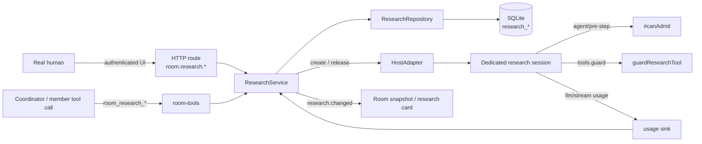
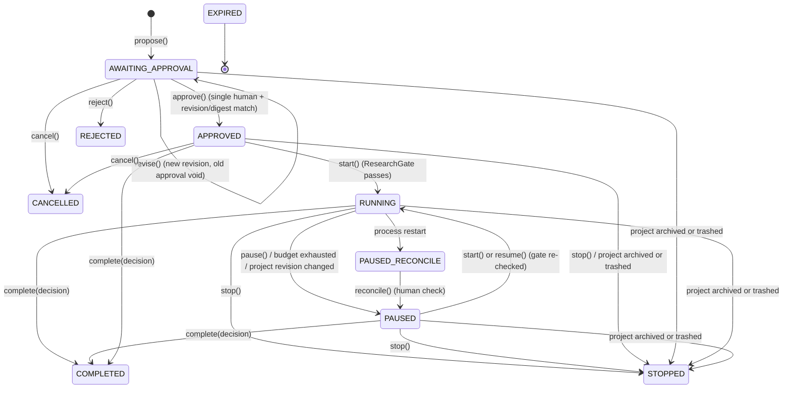
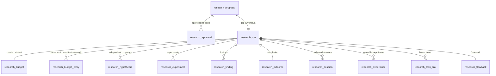

# Deep Research — Technical Documentation

English | [中文](deep-research.zh.md)

> This document describes the implementation on the current `main` branch of `dsh-project-room`. Deep research is a **supervised prototype**: approval, scope, budget, evidence and recovery paths are implemented and covered by automatable tests, but automatic research orchestration and a complete real-research demonstration are not implemented yet (see the end of this document).
>
> For the feature overview read [README](../README.md) first; this document is for people who will extend, audit or deploy the feature in code.

---

## 1. Goals and non-goals

**Goals**

- A research run can start only after a **real human explicitly approves** it; an agent cannot approve, delete or bypass.
- An approval covers **one exactly frozen proposal** (revision + scopeDigest + budget); any change to scope or budget requires a new approval.
- The budget is a **hard budget**: model calls, tokens and experiments are reserved/charged at admission, and the run pauses when exhausted.
- The process must produce **checkable evidence** (hypotheses, experiment commands, baseline/candidate commits, metrics, artifact refs, evidence levels); a conclusion cannot be established by discussion votes or model self-report.
- When the research becomes invalid (restart, project lifecycle change, approval expiry, scope change) it **fails closed** instead of silently continuing.
- A conclusion can only **flow back** into project decisions and an integration task; it never auto-merges or auto-deploys.

**Non-goals (current version)**

- No automatic research orchestration/phase loop (it does not decide "what to do next" and drive itself indefinitely).
- No general command/file sandbox: research sessions are policy-denied shell, and writes are limited to approved paths.
- No multi-human project approval (refused outright when the specific approver cannot be verified).
- No automatic cleanup of candidate patches or worktrees produced by research.

---

## 2. Components and call chain

| Layer | File | Responsibility |
|---|---|---|
| HTTP route | `src/host/api/route.js` | `room.research.*` actions on the authenticated `/api` channel; human identity resolved server-side |
| Service | `src/host/research/research-service.js` | State machine, approval, budgets, gates, evidence, flow-back, recovery |
| Repository | `src/host/research/repository.js` | SQLite reads/writes, transactions, budget reserve/commit/release, idempotency |
| Schema | `src/host/storage/store.js` (`research_*` tables) | Schema and indexes; research rows deleted with the project |
| Tool surface | `src/host/tools/room-tools.js` | The 8 `room_research_*` tools; caller identity resolved from the session map |
| Host actions | `src/host/adapter/host-adapter.js` | Creates/releases **dedicated research sessions**, wires the `agent/pre-step` gate, tool guard and usage observation |
| Composition root | `src/host/index.js` | Wires services, config defaults, usage settlement hook, startup recovery, lifecycle fence |
| Client | `client.js` | Approval card, research card, adjust dialog, pause/stop/reconcile buttons |



**Identity source**: HTTP actions arrive on the authenticated channel and the server resolves a member row as the caller; tool actions map the session id back to a member through `memberOfSession` / `researchSessionOf`. The request body contains **no** forgeable member id.

---

## 3. State machine

Values of `research_run.status`:

| Status | Meaning |
|---|---|
| `AWAITING_APPROVAL` | Proposal created, waiting for a real human decision (never starts by itself) |
| `APPROVED` | Approved, not started yet (approval ≠ run) |
| `RUNNING` | Running (dedicated research sessions active) |
| `PAUSED` | Paused by the user, after post-restart reconciliation, by a project revision change, or by budget exhaustion |
| `PAUSED_RECONCILE` | Forced reconciliation state after a process restart; a human must confirm before it returns to `PAUSED` |
| `COMPLETED` | A conclusion was submitted |
| `STOPPED` | Stopped by the user, or terminated by project archive/trash; the grant is revoked |
| `REJECTED` | The user did not approve |
| `CANCELLED` | The proposal was cancelled |
| `EXPIRED` | The approval window elapsed (discovered at an admission check) |
| `FAILED` | Reserved vocabulary value; **no current code path writes this status** |



**Key semantics**

- `APPROVED` and `RUNNING` are strictly separate: approval only writes the grant and **makes no model call**; `start()` must pass the ResearchGate again.
- Terminal states (`COMPLETED` / `STOPPED` / `REJECTED` / `CANCELLED`) cannot be restarted; `stop()` is idempotent for terminal states.
- `PAUSED` can be resumed, but resumption re-verifies the grant, scope digest, project plan revision and budget.
- `EXPIRED` is not written by a timer; it is written when `start()` / `resume()` / budget-step admission discovers that the approval expired.

**Research phases (`current_phase`, used by the UI and audit, not for authorization)**

| Phase | Entered when |
|---|---|
| `proposal` | Proposal created / revised |
| `independent` | Research starts |
| `review` | **Every** participating agent has submitted at least one hypothesis |
| `experiment` | The first experiment is recorded |
| `converge` | The first finding is recorded |
| `completed` | The conclusion is submitted |

Phases are advisory labels: the advance helper only writes when the phase actually differs, so later evidence operations can move the phase back and forth between `experiment` / `converge`; authorization and termination only look at `status`. `approved` and `stopped` are reserved vocabulary values that the current implementation never writes.

---

## 4. Proposal: freezing scope, participants and budget

`room_research_propose` or `room.research.propose` creates **one proposal + one run record with the same researchId**, written in one transaction, both in `AWAITING_APPROVAL`. This step **produces no model call, task or experiment**.

**Required input**

| Field | Description |
|---|---|
| `topic` / `objective` / `justification` | Topic, what to verify and the success criteria, and why the ordinary process is not enough |
| `participantPlan` (`participantIds` in the tool) | At least one member; must belong to this project and not be offline |
| `allowedPaths` | Paths the research may read/test, at least one; must resolve inside the project workspace |
| `hypotheses` / `expectedArtifacts` | Initial hypotheses and expected artifacts (optional) |
| `budget` | Overrides the default budget (optional), bounded by hard caps |

**Who may propose**: a real user or the coordinator; members must belong to the room and not be `offline`.

**Scope freeze**

- The workspace must be registered (`room.workspaceRef`), otherwise `RESEARCH_OUT_OF_SCOPE`.
- The workspace itself must not live inside a protected root (protected roots = the plugin root, the resolved Harness core file and its directory).
- `allowedPaths` / `excludedPaths` are normalized and `realpath`-resolved; escaping the project workspace or touching a protected path is rejected.
- Scope also freezes `allowedMemberIds`, `allowedModelProfileRefs`, and the fixed action set `['read','test','experiment','candidate-patch']`.
- Scope, participants, budget and the other proposal fields all participate in `scopeDigest` (stable JSON + SHA-256) and are frozen with the approval.

**Revision and digest**

- The first proposal has `proposalRevision = 1`; `revise()` creates a new proposal with `revision + 1`, marks the old one `SUPERSEDED` and revokes every old approval.
- Approve/reject must carry `expectedProposalRevision` and `scopeDigest`; a mismatch is rejected (`REVISION_CONFLICT` / `RESEARCH_SCOPE_CHANGED`).
- Retrying the same `idempotencyKey` returns the original result; an equivalent pending proposal with the same digest returns the existing record instead of creating a duplicate.

**Idempotency key**: defaults to `room + sourceMessageId + revision`; the tool path carries no source message, so flow-back falls back to the kickoff message as its source (see section 9).

---

## 5. Human approval

The approval record (`research_approval`) stores `proposalRevision`, `scopeDigest`, `decision`, `approvedBy`, `decidedAt`, `expiresAt`, `channelRef` (`authenticated-ui`), `idempotencyKey`, plus frozen `scope` / `budget` copies.

**Who may approve**

- Only a **real human member**: `#requireSingleHuman` requires the actor to be a human member of this project and the project to have **exactly one** active human; zero or multiple humans fail closed (`FORBIDDEN`).
- The HTTP route's human resolver also refuses projects with zero/multiple humans; agents have no approval route or tool at all.
- The approval stores the real member id in `approvedBy` as an audit fact.

**Approval semantics**

- Approval = writing one effective grant; `getEffectiveApproval()` returns the latest `decision='approved'` record that has not been revoked.
- **Validity window**: `expiresAt = decidedAt + proposal.budget.maxWallClockMs` (default 60 minutes, hard cap 7 days). After expiry, `start` / `resume` / budget-step admission refuse and set the run to `EXPIRED`.
- **No auto-start**: after approval the run stays `APPROVED`; someone must click start or call `room_research_start` to pass the gate again.
- **Reject** (`reject`): the run becomes `REJECTED` and ends; no grant is created.
- **Cancel** (`cancel`): allowed only in `AWAITING_APPROVAL` / `APPROVED` / `REJECTED`; revokes the approval, disposes research session rows, and puts proposal and run in `CANCELLED`; repeated cancels are idempotent.
- **Adjust** (`revise`): allowed only in `AWAITING_APPROVAL` / `REJECTED` / `APPROVED` (not started) / `PAUSED`; creates a new revision, revokes old approvals, and returns the run to `AWAITING_APPROVAL` for a fresh approval. Adjusting cannot extend an old approval to new scope/budget.

**Why approval and start are separate**: "the user agrees to this scope/budget" and "start spending the budget now" are two real actions, so one click cannot unexpectedly produce model calls.

---

## 6. ResearchGate: start checks

`start()` checks in order; any failure rejects or pauses:

| Check | Failure result |
|---|---|
| Research feature enabled | `RESEARCH_DISABLED` |
| Run exists | `RESEARCH_NOT_FOUND` |
| Project is active | Rejected by RoomService (`ROOM_PAUSED` / `ROOM_ARCHIVED` etc.) |
| Current status is `APPROVED` or `PAUSED` | `RESEARCH_NOT_AUTHORIZED` |
| An effective approval record exists | `RESEARCH_NOT_AUTHORIZED` |
| `approval.scopeDigest === proposal.scopeDigest` | `RESEARCH_SCOPE_CHANGED` |
| Approval not revoked | `RESEARCH_NOT_AUTHORIZED` |
| Approval not expired | Sets `EXPIRED`, then `RESEARCH_NOT_AUTHORIZED` |
| `room.planRevision === run.basePlanRevision` | Sets `PAUSED`, `RESEARCH_PROJECT_VERSION_CHANGED` |
| Used calls < limit | Sets `PAUSED`, `RESEARCH_BUDGET_EXCEEDED` |

**After passing**: the first start writes the budget ledger (`research_budget` with the approved budget and `startedAt`); the run becomes `RUNNING`, phase `proposal → independent`, `startedAt` recorded; a research discussion `research-discussion-<id>` is created; a `research.started` event is appended.

**Dedicated sessions**: when the host supports owned sessions, one dedicated research session is created per online agent participant (failures are logged per member and do not block the others), a `research_session` row is written, and one scope-limited kickoff instruction is sent. Without dedicated sessions, the service falls back to a group kickoff message from the coordinator mentioning the participants.

---

## 7. Budget and usage settlement

**Fields and defaults**

| Budget item | Config default | Hard cap (per research) |
|---|---|---|
| `maxModelCalls` | 32 | 1000 |
| `maxTotalTokens` | 120000 | 10,000,000 |
| `maxWallClockMs` | 3,600,000 (60 minutes) | 604,800,000 (7 days) |
| `maxExperimentRuns` | 10 | no additional hard-coded cap |
| `maxParallelAgents` | 3 (and no more than the participant count) | none |

- All values must be positive integers; config validation rejects 0/negative values, and `#budget()` rejects combinations above the hard caps (`INVALID_REQUEST`).
- One proposal may override the values within those bounds; `revise()` merges new values over the old budget and re-validates.
- `maxParallelAgents` is validated, persisted and displayed, but **no runtime enforcement point exists today**: admission serializes turns of the same research through `activeResearchTurns`.

**Ledger model (`research_budget` + `research_budget_entry`)**

- One budget row per research, holding `max_*`, `reserved_*` and `used_*`.
- Every admission calls `reserveBudget()` first: inside a transaction it checks `used + reserved + this <= max` (calls / tokens / experiments separately), then writes a `reserved` entry and increments the reserved counters.
- `commitBudget()` turns a reservation into usage (one experiment, at least one model call, tokens = `max(reserved, actual)`); `releaseBudget()` releases a reservation on failure/cancel.
- Real order for experiment registration: **reserve the experiment slot → write the experiment record → commit the reservation**; if writing the record fails the reservation is released, so a crash cannot leave a silent extra experiment or a permanent fake reservation.
- Idempotency: the same `(researchId, idempotencyKey)` reservation is created once; duplicates return the existing entry.

**Usage settlement**

- The adapter reports usage when an `llm/stream` ends; it reaches `recordModelUsage()` through the host usage event: `usedCalls += 1`, `usedTokens += actual tokens` (only when the provider actually reports usage; zero is never invented).
- After settlement, if `usedCalls >= maxCalls` or `usedTokens >= maxTokens`, the run is immediately set to `PAUSED` with reason `RESEARCH_BUDGET_EXCEEDED`, and a `research.paused` event is appended.
- **Honest gap**: the host offers no atomic per-step token reservation token, so the budget is "reserve + settle afterwards"; serialization reduces but cannot absolutely eliminate a one-call overshoot. This document does not describe it as a hard real-time quota.

**Wall-clock semantics**

- `maxWallClockMs` is currently the **approval validity window**, not a runtime countdown: `expiresAt` is computed from it at approval time; a running research is never terminated by a timer, and expiry is discovered at `#assertGrant` call sites (start / resume / budget-step admission such as experiments).
- The dedicated session's `agent/pre-step` gate (`#canAdmit`) checks run state, project state, plan revision and remaining calls/tokens; it **does not check approval expiry**, which is eventually discovered at a budget step or the next start/resume.
- The UI shows "N minute limit" from `budget.maxWallClockMs` in the snapshot.

---

## 8. Dedicated research sessions and runtime gates

A research session is **not a room member**: it has no member row, cannot send/receive normal room messages, and cannot be mentioned by other members.

**At creation (`HostAdapter.createResearchSession`)**

- `sessionId = newSessionId(roomId, 'research-<researchId>-<memberId>')`; `meta` carries `researchId`, `cwd` (project workspace) and the agent preset.
- Registers `agent/pre-step`: calls `#canAdmit(sessionId)` and returns `{ kind: 'reject' }` when false, **before the provider call**.
- Registers `agent/request`: forces the provider/model resolved for the participant at approval time and records the observed route.
- Registers `llm/stream`: wraps usage observation and carries `researchId` into settlement for exact per-research attribution.
- Injects the research persona system prompt; mounts the project's configured agent preset (so members keep file/command tools where configured).
- `tools.guard(guardResearchTool)`: policy-level denial at the tool level.
- `tools.restrict`: disables every `room_*` tool that is **not** `room_research_*`.

**`#canAdmit` (synchronous pre-call gate) checks**

1. No turn of the same research is in flight (serialization);
2. The run exists and is `RUNNING`;
3. The project `status === 'active'`;
4. Both proposal and effective approval exist;
5. `room.planRevision === run.basePlanRevision`;
6. `usedCalls < maxCalls` and `usedTokens < maxTokens`;
7. On success it marks `activeResearchTurns`, cleared when the usage observation arrives.

Any failure rejects the step; this is the runtime gate that enforces "budget exhausted / project paused / restart reconciliation blocks continuation".

**`guardResearchTool` (policy-level tool denial, not an OS sandbox)**

| Tool | Behaviour |
|---|---|
| Normal room tools `room_*` (not `room_research_*`) | Denied: cannot impersonate a normal member |
| `pwsh` / `bash` / `shell` / `exec` / `run_code` | Denied: the supervised prototype does not allow research sessions to run shell |
| `write` / `edit` / `str_replace_editor` / `apply_patch` etc. | Reads `path` / `file_path` / `filePath` / `target`, resolves the real path via `resolveInside(workspaceRoot, raw)`; must be inside `allowedPaths` and not inside `excludedPaths` |

**Lifecycle**

- Live map in the adapter plus durable `research_session` rows (`active` → `stale` (restart) → `disposed`).
- Pause: cancels in-flight turns but keeps sessions and budget; stop/complete/archive/trash: cancels, marks `disposed`, disposes sessions asynchronously.
- A failed dispose is never reported as success: the resource-ownership ledger lists leftover research-session resources, and permanent deletion reports "cleanup blocked".

---

## 9. Evidence protocol, conclusions and flow-back

**Evidence objects**

| Object | Key fields | Rules |
|---|---|---|
| Hypothesis `research_hypothesis` | `claim`, `predictedEffect`, `falsificationTest`, `evidenceRefs`, author | Only participants may submit; the `independent` phase advances to `review` only when **every agent** has at least one hypothesis (one member submitting twice does not count) |
| Experiment `research_experiment` | `hypothesisId`, `baselineCommit`, `candidateCommit`, `environmentRef`, `commandRefs`, `metrics`, `artifactRefs` | Each registration consumes one experiment budget slot; reserve first, write second; `commandRefs` must be commands actually run / reproducible steps |
| Finding `research_finding` | `issue`, `evidenceLevel` (`fact` / `reproducible` / `hypothesis` / `unverified`), `supportingRefs`, `counterRefs`, `recommendation`, `uncertainty` | Evidence level is required; discussion votes and model self-report must not be labelled as fact |
| Outcome `research_outcome` | `decision`, `chosenCandidateRef`, `baselineEvidenceRefs`, `regressionEvidenceRefs`, `remainingRisks`, `acceptedBy` | 1:1 with the research; `improved` requires both baseline and regression evidence, otherwise `INVALID_REQUEST` |

**Conclusion enum**: `improved` (verifiable improvement), `no_change` (keeping the status quo is better), `inconclusive` (insufficient evidence), `rejected_candidate` (candidate rejected). `complete()` may close a run from `RUNNING` / `PAUSED` / `APPROVED`; it writes the outcome, closes the discussion, revokes the approval, releases dedicated sessions, and when `reusableLesson` is supplied writes one `research_experience` row (`review_status = draft`).

**Flow-back (`room_research_flowback` / `room.research.flowback`)**

- Only a **completed** research can flow back, and only the **project's coordinator** may do it; each research flows back once (primary key on `research_flowback`; repeated calls return the existing result).
- A real source message is required: the proposal's `sourceMessageId`, or the kickoff message (client key `research-kickoff-<researchId>`).
- Flow-back outputs:
  1. one **Decision** sourced from that message (`accept: true`, `scope: 'research'`; conclusion/candidate/remaining risks in the statement);
  2. if the conclusion is `improved`, **one integration Task** (implement the candidate per the conclusion, with acceptance criteria); never auto-merge or auto-deploy;
  3. one `research-report` **Artifact** (`verified: false`, an evidence index, not a verified artifact);
  4. a `research_flowback` record plus a `research_task_link` (`kind: 'integration'`); when a task was created, the task revision and acceptor are written back to the outcome.

---

## 10. Tools and HTTP surface

**Model tools (8, on the host tool surface)**

| Tool | Caller | Purpose |
|---|---|---|
| `room_research_propose` | Real user or coordinator | Create a pending proposal; never starts |
| `room_research_get` | Room members | Read the summary (proposal/approval/run/budget/evidence/outcome) |
| `room_research_start` | Coordinator | Start after approval through the ResearchGate; refuses without a valid grant |
| `room_research_hypothesis` | Participants / research sessions | Submit a falsifiable hypothesis |
| `room_research_experiment` | Participants / research sessions | Register a real experiment and consume experiment budget |
| `room_research_finding` | Participants / research sessions | Submit a finding with an evidence level |
| `room_research_report` | Coordinator | Close the research with a conclusion; `improved` needs baseline + regression evidence |
| `room_research_flowback` | Coordinator | Flow the completed conclusion back into Decision / integration Task / Artifact |

There is **no** agent-callable approve/reject/cancel/pause/delete tool; those exist only on the human UI channel.

**HTTP actions (authenticated `/api` channel)**

| Action | Identity | Description |
|---|---|---|
| `room.research.list` / `get` / `report` | Authenticated UI (read-only) | All return the same summary structure |
| `room.research.propose` | Authenticated UI (service requires real user or coordinator) | Create a proposal |
| `room.research.approve` / `reject` | Single real human | Must carry revision + `scopeDigest` + `idempotencyKey` |
| `room.research.cancel` | Single real human | Cancel an unstarted proposal |
| `room.research.revise` | Authenticated UI (service requires real user or coordinator) | Create a new revision; old approval void |
| `room.research.start` | Authenticated UI (human triggered; the tool path requires the coordinator) | Start through the gate |
| `room.research.pause` / `resume` / `stop` | Authenticated UI (route resolves a single real human) | Run control |
| `room.research.reconcile` | Single real human | Post-restart reconciliation → `PAUSED` |
| `room.research.experience` / `sessions` | Authenticated UI (read-only) | Project experience / research session records |
| `room.research.flowback` | Authenticated UI (service requires the coordinator) | Flow-back |

**Client behaviour**: the research card renders only for `AWAITING_APPROVAL` / `APPROVED` / `RUNNING` / `PAUSED` / `PAUSED_RECONCILE` / `COMPLETED`; approval buttons carry the current revision and digest; saving an adjustment creates a new proposal revision; every action refetches the room snapshot (`research.changed` is only a refresh signal).

---

## 11. Data model



| Table | Primary key | Key index/constraint |
|---|---|---|
| `research_proposal` | `id` | unique `idempotency_key`; `(room_id, created_at)` |
| `research_approval` | `id` | unique `idempotency_key`; `(research_id, decided_at)` |
| `research_run` | `id` | unique `idempotency_key`; `(room_id, created_at)` |
| `research_budget` | `research_id` | 1:1 with the run |
| `research_budget_entry` | `id` | unique `(research_id, idempotency_key)` |
| `research_hypothesis` / `research_experiment` / `research_finding` | `id` | queried by `research_id` |
| `research_outcome` | `research_id` | 1:1, upsert |
| `research_experience` | `id` | queried by source research/project; `review_status` defaults to `draft` |
| `research_task_link` | `(research_id, task_id)` | index on `task_id` |
| `research_flowback` | `research_id` | 1:1; duplicate flow-back returns the existing record |
| `research_session` | `session_id` | `(research_id, created_at)` |

Permanent project deletion deletes that project's research rows (including dedicated session rows); host resources of dedicated sessions are released through the lifecycle resource ledger, and a failure is reported as "cleanup blocked". Deletion does not cascade to source messages/tasks (research references are evidence only).

---

## 12. Security boundaries and threat model

| Threat | Control |
|---|---|
| An agent claims "already approved" and starts | No agent approval entry; `start` must read a persisted grant; approval is written only by a single human on the authenticated UI |
| Forging an approver / impersonation in multi-human projects | Human identity resolved server-side; zero or >1 humans fail closed; `approvedBy` is a real member row |
| Reusing an old approval after a "budget/scope adjustment" | `revise` revokes all old approvals; approval binds `proposalRevision + scopeDigest`, so changes invalidate it |
| Escaping approved paths via symlink/junction | Write paths are resolved to real paths (`resolveInside` + `realpath`) before allowed/excluded checks; escapes are rejected and tested |
| Research sessions running shell with unauditable side effects | `guardResearchTool` explicitly denies shell tools; experiments are run by supervised members with command refs |
| Unbounded budget / denial of service | Proposal hard caps + budget ledger + automatic pause on exhaustion |
| Continuing after approval expiry | Expiry is checked at gates and sets `EXPIRED`; `expiresAt` is frozen with the budget |
| Reusing research authorization after archive/trash | Lifecycle transitions revoke the approval, stop the research and release sessions; restore requires a new approval |
| Double click / retry producing two operations | Unique `idempotencyKey` indexes + revision checks for approve/cancel/stop etc. |
| Agent reading research across projects | Tools map the caller session to a member, `roomId` comes from the member row; participants must belong to the room |

What is explicitly **not** covered: research sessions can still use the file tools the host mounts for members (inside approved paths) — that is a policy limit, not OS isolation; conclusion correctness depends on evidence quality — the system only guarantees that evidence references exist and conclusions are honestly shaped, not that experiments really ran.

---

## 13. Failure, recovery and project lifecycle

**Restart recovery**

- On plugin activation `recoverStaleRuns()` moves every `RUNNING` research to `PAUSED_RECONCILE` (reason `PROCESS_RESTART`), marks dedicated sessions `stale`, clears in-flight turns, and appends `research.paused` (`reconcile: true`).
- A human clicks "reconcile" in the UI → `reconcile()` requires a single real human and moves the run to `PAUSED`; an explicit `start`/`resume` is still required afterwards, re-checking the grant, digest, project revision and budget.
- Research **never** continues automatically after a restart.

**Project lifecycle fence**

| Project action | Effect on research |
|---|---|
| Pause | Research becomes `PAUSED` (not terminal); the dedicated session's pre-step rejects because the project is not active; budget/approval are kept |
| Archive / move to recycle bin | Research becomes `STOPPED`; approval revoked, dedicated sessions released, research discussion closed; restoring the project cannot reuse the old approval |
| Restore | Returns only to paused; a terminated research must be proposed/approved again |
| Permanent delete | Deletes research rows; the resource ledger releases dedicated sessions first and reports `PURGE_BLOCKED` on failure |

**Idempotency and retries**: every create/approve/close/flow-back action has an idempotency key or unique constraint; repeated clicks never produce a second real side effect.

---

## 14. Observability

**Room events** (persisted in `room_event`, replayable in order)

`research.proposed`, `research.approval_decided`, `research.started`, `research.paused`, `research.hypothesis_recorded`, `research.experiment_recorded`, `research.finding_recorded`, `research.phase_changed`, `research.completed`, `research.flowed_back`, `research.cancelled`, `research.stopped`.

**Summary structure** (returned by HTTP list/get/report): `enabled`, `pending`, `proposal`, `run`, `approval`, `budget`, `hypotheses`, `experiments`, `findings`, `outcome`, `flowback`, `discussion`, `sessions`, `experience`, `history` (recent proposals/runs).

**UI**: approval card (topic/objective/justification/participants/budget/paths/approve-reject-cancel-adjust), run card (status/phase/budget/approver/experiments/findings/experience/sessions/scopeDigest), adjust dialog (5 budget fields + allowed/excluded paths), pause/resume/stop/reconcile buttons, natural-Chinese error labels.

**Logs**: dedicated session creation failures, kickoff failures, dispose failures and recovery failures log `[project-room] ...` warnings; the pre-crash phase trail is in `boot-trace.jsonl`.

---

## 15. Configuration

Plugin config object (the `config` of the `project-room` row in the profile's `cordis.patch.yml`, or the plugin's own bundle patch):

```yaml
- id: project-room
  config:
    research:
      enabled: true
      maxModelCalls: 32
      maxTotalTokens: 120000
      maxWallClockMs: 3600000   # 60 minutes; hard cap 604800000 (7 days)
      maxExperimentRuns: 10
      maxParallelAgents: 3
```

- These are **default suggestions for new proposals**; a proposal/adjustment may still change them within the hard caps.
- Validation: every budget value must be a positive integer; `enabled` must be a boolean.
- With `research.enabled = false`, the read-only summary returns `{ enabled: false }`; propose/approve/reject/cancel/revise/start entry points throw `RESEARCH_DISABLED` (closing actions such as pause/stop/reconcile can still operate on an existing run), and the UI hides the research card.
- Research introduces no extra runtime dependency (pure Node built-ins + sqlite).

---

## 16. Tests and verification

`tests/integration/research-approval.test.js` covers (22 scenarios):

- Cannot start before approval; approve/start idempotent; reject leaves no grant;
- Adjusting budget/scope invalidates the old approval; out-of-scope paths rejected; junction escape rejected; workspace inside a protected root rejected;
- Experiment budget reserved atomically and refuses when exhausted; real usage above budget pauses;
- Phases advance through independent → review → experiment → converge; restart requires reconciliation; multi-human fails closed;
- Dedicated sessions have a pre-step gate and normal room tools denied; `improved` requires regression evidence; `no_change` passes honestly;
- One flow-back creates one Decision and one integration Task; pause/resume/stop terminal behavior; project plan revision change pauses;
- Participant model binding does not invent a model; cancelled proposal refuses approval/start; expired approval sets `EXPIRED`; trash stops research and revokes the grant.

Run:

```powershell
node --experimental-vm-modules --experimental-test-isolation=none --test tests/integration/research-approval.test.js
npm run test        # full unit + integration
npm run check       # syntax gate + generated file up to date
```

---

## 17. Known limitations and not-yet-implemented

- **Supervised prototype**: no automatic research orchestration/phase loop; no complete real-research demonstration.
- **Research sessions cannot run shell**: experiments must be executed by members under supervision and registered with commands/evidence.
- **No pre-call interception on shared member sessions**: gates apply only to dedicated research sessions; model calls made in normal member sessions are not bound by the research budget.
- **Wall clock is the approval window, not a runtime timer**: a running research is not stopped at the deadline; expiry is discovered at gate points. `maxParallelAgents` is validated/displayed but not enforced at runtime.
- **Call-level budget overshoot is possible**: the host has no per-step token reservation token, so the design is "reserve + settle afterwards + serialize".
- **Single-human restriction**: multi-human projects cannot verify the approver, so research approval is disabled for them.
- **`FAILED` / `approved` phase / `stopped` phase are reserved vocabulary**: the current implementation never writes them; `status` and events are authoritative.
- **Experience governance is incomplete**: `research_experience` is written as `draft`; there is no product-level review/promotion flow.
- **No auto-merge/deploy**: flow-back only creates a Decision / integration Task / report Artifact; landing the candidate goes through the normal task flow.
- **The UI shows only some terminal states**: cancelled/rejected/expired/stopped runs no longer render the research card (their data is still readable in the summary/history).

---

## 18. Source map

| File | Contents |
|---|---|
| `src/host/research/research-service.js` | State machine, approval, budget, gates, evidence, flow-back, recovery (1400+ lines) |
| `src/host/research/repository.js` | Research table reads/writes, budget transactions, idempotency, mapping |
| `src/host/storage/store.js` | `research_*` schema, indexes, project cleanup |
| `src/host/api/route.js` | `room.research.*` route actions and human identity resolution |
| `src/host/tools/room-tools.js` | The 8 `room_research_*` tool definitions |
| `src/host/adapter/host-adapter.js` | Dedicated research session creation/release, pre-step, tool guard, usage observation |
| `src/host/index.js` | Service wiring, budget defaults, startup recovery, lifecycle fence, usage settlement hook |
| `client.js` | Research card, approval card, adjust dialog, action dispatch |
| `tests/integration/research-approval.test.js` | Permission, budget, gate, recovery, flow-back tests |
| `shared/contracts.js` | Route constants and error shape |

---

## Appendix A: Error codes

| Code | Meaning |
|---|---|
| `RESEARCH_DISABLED` | Research feature disabled / service not mounted |
| `RESEARCH_NOT_FOUND` | Research / proposal / budget reservation not found |
| `RESEARCH_NOT_AUTHORIZED` | No valid approval, approval expired/revoked, or not in an allowed state |
| `RESEARCH_INVALID_STATE` | The current state does not allow this operation |
| `RESEARCH_SCOPE_CHANGED` | scopeDigest does not match the approval; re-approval required |
| `RESEARCH_OUT_OF_SCOPE` | Path/workspace outside the approved scope or inside a protected root |
| `RESEARCH_BUDGET_EXCEEDED` | Budget exhausted (reservation refused or pause after settlement) |
| `RESEARCH_BUDGET_MISSING` | Budget ledger missing; admission refused |
| `RESEARCH_PROJECT_VERSION_CHANGED` | Project plan revision changed; research paused for reconciliation |
| `FORBIDDEN` | Identity refused (not human / not coordinator / multi-human project, etc.) |
| `REVISION_CONFLICT` | Proposal revision changed |
| `INVALID_REQUEST` | Invalid parameter or conclusion (e.g. `improved` without evidence) |

## Appendix B: One complete research (operator view)

1. **Propose**: the coordinator (or the user in the UI) creates a proposal with topic/objective/justification/participants/allowed paths/optional budget.
2. **Approve**: a real user clicks "approve this research" on the approval card (or rejects/cancels/adjusts). The approval has a validity window (default 60 minutes); after expiry a new approval is required.
3. **Start**: the user or coordinator clicks "start research" / calls `room_research_start`; once the ResearchGate passes, the status is `RUNNING` and participating members get dedicated research sessions.
4. **Independent proposals**: every agent participant submits hypotheses; once all have submitted, the phase moves to review.
5. **Experiments**: members run real commands under supervision and register them through `room_research_experiment` with commands, baseline/candidate commits, metrics and artifacts; each consumes experiment budget.
6. **Findings**: submit findings with evidence levels (supporting/counter references, recommendation, uncertainty).
7. **Conclusion**: the coordinator calls `room_research_report`; `improved` requires baseline + regression evidence.
8. **Flow-back**: the coordinator calls `room_research_flowback`, creating a Decision (and an integration Task when improved) plus an unverified report Artifact.
9. **Archive**: archiving/trashing the project stops the research and revokes the grant; after a restart a human must reconcile before anything continues.
