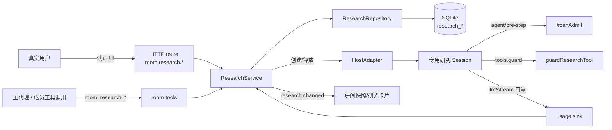
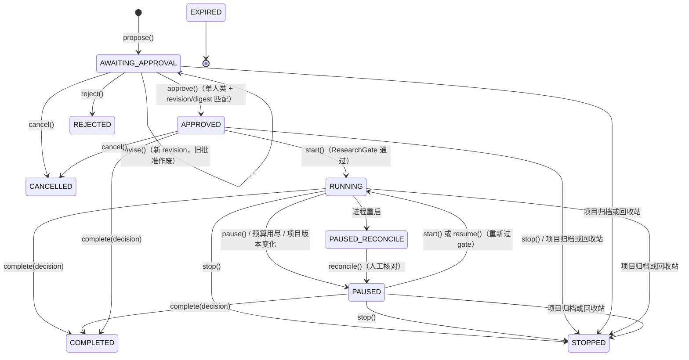
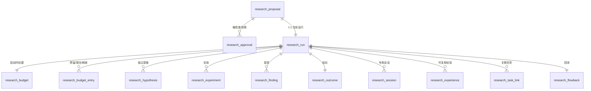

# 深度研究技术文档（Deep Research）

中文 | [English](deep-research.md)

> 本文描述 `dsh-project-room` 当前 `main` 分支的实现。深度研究是**受监督原型**：审批、范围、预算、证据与恢复链路已经实现并有可自动化测试，但自动研究编排、完整自主研究演示等仍未实现（见文末）。
>
> 阅读前建议先看 [README](../README.zh.md) 的功能概述；本文面向要在代码上继续开发、审计或部署该功能的人。

---

## 1. 设计目标与非目标

**目标**

- 研究只能由**真实用户明确批准**后启动；代理不能批准、不能删除、不能绕过。
- 批准只覆盖**一份精确冻结的提议**（revision + scopeDigest + budget），范围或预算一旦变化就必须重新审批。
- 预算是**硬预算**：模型调用、tokens、实验次数在准入时扣减/预留，用尽即暂停。
- 研究过程必须产生**可核对证据**（假设、实验命令、基线/候选 commit、指标、产物引用、证据级别），结论不能靠讨论投票或模型自述成立。
- 研究失效（重启、项目生命周期变化、批准过期、范围变化）时 **fail-closed**，不静默继续。
- 研究产生的结论只能**回流**为项目决定与集成任务，不自动合并、不自动部署。

**非目标（当前版本）**

- 不做自动研究编排/阶段循环（不会自己决定“下一步该做什么”并无限推进）。
- 不提供通用命令/文件沙箱：研究会话被策略性禁止 shell，写入仅限批准路径。
- 不支持多人类项目审批（无法验证具体审批人时直接拒绝）。
- 不自动清理研究产生的候选补丁或 worktree。

---

## 2. 组件与调用链

| 层 | 文件 | 职责 |
|---|---|---|
| HTTP 路由 | `src/host/api/route.js` | 已认证 `/api` 通道上的 `room.research.*` 动作；人类身份在服务端解析 |
| 服务 | `src/host/research/research-service.js` | 状态机、审批、预算、门禁、证据、回流、恢复 |
| 仓储 | `src/host/research/repository.js` | SQLite 读写、事务、预算预留/提交/释放、幂等 |
| 表结构 | `src/host/storage/store.js`（`research_*` 表） | schema 与索引；项目清理时删除研究数据 |
| 工具面 | `src/host/tools/room-tools.js` | 8 个 `room_research_*` 工具；调用者身份由会话映射解析 |
| 宿主动作 | `src/host/adapter/host-adapter.js` | 创建/释放**专用研究会话**，挂 `agent/pre-step` 门禁、工具 guard、用量观测 |
| 组合根 | `src/host/index.js` | 装配服务、配置默认值、用量结算钩子、启动恢复、生命周期 fence |
| 客户端 | `client.js` | 审批卡、研究卡片、调整对话框、暂停/停止/核对按钮 |



**身份来源**：HTTP 动作来自已认证通道，服务端把某个成员行解析为调用者；工具动作通过 `memberOfSession` / `researchSessionOf` 把会话 id 映射回成员。请求体里**没有**可伪造的成员 id。

---

## 3. 状态机

研究运行（`research_run.status`）取值：

| 状态 | 含义 |
|---|---|
| `AWAITING_APPROVAL` | 提议已创建，等待真实用户批准（不会自动开始） |
| `APPROVED` | 已批准，但尚未启动（批准 ≠ 运行） |
| `RUNNING` | 运行中（专用研究会话活跃） |
| `PAUSED` | 用户暂停、重启核对后暂停、范围/版本变化或预算用尽导致暂停 |
| `PAUSED_RECONCILE` | 进程重启后的强制核对态；必须由人确认后才能回到 `PAUSED` |
| `COMPLETED` | 已提交结论 |
| `STOPPED` | 用户停止，或项目归档/回收站导致终止；批准已撤销 |
| `REJECTED` | 用户不批准 |
| `CANCELLED` | 提议被取消 |
| `EXPIRED` | 批准有效期已过（在准入检查时被发现） |
| `FAILED` | 词汇表保留值；**当前没有代码路径会写入该状态** |



**关键语义**

- `APPROVED` 与 `RUNNING` 严格分开：批准只写入 grant，**不会调用任何模型**；必须再经过一次 `start()` 的 ResearchGate。
- 终止态（`COMPLETED` / `STOPPED` / `REJECTED` / `CANCELLED`）不可重新启动；`stop()` 对终止态幂等返回。
- `PAUSED` 可以恢复，但恢复同样要重新校验 grant、scope digest、项目计划版本与预算。
- `EXPIRED` 不是定时器主动写入，而是在 `start()` / `resume()` / 预算步骤准入时发现批准过期后写入。

**研究阶段（`current_phase`，用于 UI 与审计，不参与授权）**

| 阶段 | 进入条件 |
|---|---|
| `proposal` | 提议创建 / 修订 |
| `independent` | 研究启动 |
| `review` | **所有**参与 agent 都至少提交过一条假设 |
| `experiment` | 第一次登记实验 |
| `converge` | 第一条发现 |
| `completed` | 提交结论 |

阶段是提示性标签：推进逻辑只在阶段不同时写入，因此后续证据操作可能让阶段在 `experiment` / `converge` 之间回退；授权与终止只看 `status`。`approved`、`stopped` 是词汇表保留值，当前实现不会写入这些阶段。

---

## 4. 提议：范围、参与者与预算的冻结

`room_research_propose` 或 `room.research.propose` 创建**一个提议 + 一条同 researchId 的运行记录**，两者在同一个事务里写入，状态均为 `AWAITING_APPROVAL`。这一步**不产生任何模型调用、任务或实验**。

**必填内容**

| 字段 | 说明 |
|---|---|
| `topic` / `objective` / `justification` | 主题、要验证什么与成功标准、为什么普通流程不够 |
| `participantPlan`（工具里叫 `participantIds`） | 至少一位成员；必须属于本项目、非离线 |
| `allowedPaths` | 研究允许读/试验的路径，至少一个；必须解析到项目工作区内 |
| `hypotheses` / `expectedArtifacts` | 初始假设与预期产物（可选） |
| `budget` | 覆盖默认预算（可选），受硬上限约束 |

**参与成员资格**：真实用户或主代理可发起；成员必须属于该房间且 `status !== 'offline'`。

**范围冻结（scope）**

- 工作区必须已登记（`room.workspaceRef`），否则 `RESEARCH_OUT_OF_SCOPE`。
- 工作区本身不能位于受保护根内（受保护根 = 插件根目录、解析到的 Harness 核心文件及其目录）。
- `allowedPaths` / `excludedPaths` 会做规范化 + `realpath` 解析；越出项目工作区、包含受保护路径都直接拒绝。
- 冻结进 scope 的还有：`allowedMemberIds`、`allowedModelProfileRefs`、固定动作集 `['read','test','experiment','candidate-patch']`。
- scope、participants、budget 等全部参与 `scopeDigest` 计算（stable JSON + SHA-256），并随批准一起冻结。

**revision 与 digest**

- 首次提议 `proposalRevision = 1`；`revise()` 会生成 `revision + 1` 的新提议，旧提议标记 `SUPERSEDED` 并撤销所有旧批准。
- 批准/拒绝必须显式携带 `expectedProposalRevision` 与 `scopeDigest`；两者任一与当前提议不符即拒绝（`REVISION_CONFLICT` / `RESEARCH_SCOPE_CHANGED`）。
- 同一 `idempotencyKey` 重试返回原结果；相同 digest 的等价待批准提议会直接返回已有记录，不重复创建。

**幂等键**：`idempotencyKey` 缺省由 `room + sourceMessageId + revision` 组合生成；工具路径不携带来源消息，因此回流时改用启动说明消息作为来源（见第 9 节）。

---

## 5. 人工审批

审批记录（`research_approval`）字段包含 `proposalRevision`、`scopeDigest`、`decision`、`approvedBy`、`decidedAt`、`expiresAt`、`channelRef`（`authenticated-ui`）、`idempotencyKey`，以及冻结的 `scope` / `budget` 副本。

**谁能批准**

- 只有**真实人类成员**：服务端 `#requireSingleHuman` 要求调用者是本项目人类成员，且项目当前**恰好只有一个**活跃人类；0 个或多个人类都 fail-closed（`FORBIDDEN`）。
- HTTP 路由的人类身份解析器同样拒绝 0/多人项目；代理没有任何可调用的批准路由或工具。
- 批准写入 `approvedBy` 为真实成员 id，作为审计事实。

**批准语义**

- 批准 = 写入一条有效 grant；`getEffectiveApproval()` 取最近一条 `decision='approved'` 且未撤销的记录。
- **有效期**：`expiresAt = decidedAt + proposal.budget.maxWallClockMs`（默认 60 分钟，硬上限 7 天）。过期后 `start` / `resume` / 预算步骤准入会拒绝并把运行置为 `EXPIRED`。
- **不自动启动**：批准后运行停留在 `APPROVED`，必须由主代理/用户点击开始或调用 `room_research_start` 再走一次 gate。
- **不批准**（`reject`）：运行进入 `REJECTED` 并结束，不创建 grant。
- **取消**（`cancel`）：仅待批准/已批准/已拒绝可取消；撤销批准、释放专用会话行、提议与运行都进入 `CANCELLED`；重复取消幂等。
- **调整**（`revise`）：仅待批准/已拒绝/已批准未启动/已暂停可改；生成新 revision、撤销旧批准，运行回到 `AWAITING_APPROVAL`，必须重新批准。调整不能把旧批准延伸给新范围/预算。

**批准与启动分离的原因**：把“用户同意这个范围/预算”与“现在开始花预算”拆成两次真实动作，避免点击一次按钮就产生不可预期的模型调用。

---

## 6. ResearchGate：启动检查

`start()` 依次检查，任一失败即拒绝或暂停：

| 检查 | 失败结果 |
|---|---|
| 研究功能已启用 | `RESEARCH_DISABLED` |
| 运行存在 | `RESEARCH_NOT_FOUND` |
| 项目处于 active | 由 RoomService 拒绝（`ROOM_PAUSED` / `ROOM_ARCHIVED` 等） |
| 当前状态为 `APPROVED` 或 `PAUSED` | `RESEARCH_NOT_AUTHORIZED` |
| 存在有效批准记录 | `RESEARCH_NOT_AUTHORIZED` |
| `approval.scopeDigest === proposal.scopeDigest` | `RESEARCH_SCOPE_CHANGED` |
| 批准未被撤销 | `RESEARCH_NOT_AUTHORIZED` |
| 批准未过期 | 置 `EXPIRED` 后 `RESEARCH_NOT_AUTHORIZED` |
| `room.planRevision === run.basePlanRevision` | 置 `PAUSED`，`RESEARCH_PROJECT_VERSION_CHANGED` |
| 已用调用数 < 上限 | 置 `PAUSED`，`RESEARCH_BUDGET_EXCEEDED` |

**通过后**：首次启动写入预算账本（`research_budget`，值为批准时冻结的预算与 `startedAt`）；运行置 `RUNNING`，阶段 `proposal → independent`，记录 `startedAt`；创建研究讨论专题 `research-discussion-<id>`；写 `research.started` 事件。

**专用会话创建**：若宿主支持 owned session，为每位在线的 agent 参与者创建专用研究会话（失败按成员逐条告警、不阻塞其余成员），写入 `research_session` 行，并发送一次范围受限的启动说明。若没有专用会话，则退化为向主代理发送一条群内启动说明（把参与成员作为 mention）。

---

## 7. 预算与用量结算

**字段与默认值**

| 预算项 | 配置默认 | 硬上限（单次研究） |
|---|---|---|
| `maxModelCalls` | 32 | 1000 |
| `maxTotalTokens` | 120000 | 10,000,000 |
| `maxWallClockMs` | 3,600,000（60 分钟） | 604,800,000（7 天） |
| `maxExperimentRuns` | 10 | 无额外硬编码上限 |
| `maxParallelAgents` | 3（且不超过参与人数） | 无 |

- 所有值必须是正整数；配置校验拒绝 0/负数，服务层 `#budget()` 拒绝超过硬上限的组合（`INVALID_REQUEST`）。
- 单次提议可在这些值内覆盖；`revise()` 在旧预算基础上合并新值并重新校验。
- `maxParallelAgents` 会被校验、持久化并展示，但**当前运行期没有并行度强制点**：专用会话的准入用 `activeResearchTurns` 把同一次研究的轮次串行化。

**账本模型（`research_budget` + `research_budget_entry`）**

- 预算行 1:1 对应研究；含 `max_*`、`reserved_*`、`used_*`。
- 每次准入先 `reserveBudget()`：在事务里检查 `used + reserved + 本次 <= max`（调用/ tokens / 实验分别检查），通过则写一条 `reserved` 账目并增加 reserved。
- `commitBudget()`：把预留转为已用（实验 1 次、模型调用至少 1 次、tokens 取 `max(预留, 实际)`）；`releaseBudget()`：失败/取消时释放预留。
- 实验登记的真实顺序：**先预留实验次数 → 写实验记录 → 提交预留**；若写记录失败则释放预留，避免崩溃留下“静默多一次实验”或“永久的假预留”。
- 幂等：同一 `(researchId, idempotencyKey)` 的预留只会创建一次，重复请求返回已有账目。

**用量结算**

- 适配器在 `llm/stream` 结束时上报 usage，经宿主 `usage` 事件进入 `recordModelUsage()`：`usedCalls += 1`、`usedTokens += 实际 tokens`（仅在提供方真的报告 usage 时；不伪造 0）。
- 结算后若 `usedCalls >= maxCalls` 或 `usedTokens >= maxTokens`，立即把运行置 `PAUSED`，原因 `RESEARCH_BUDGET_EXCEEDED`，并写 `research.paused` 事件。
- **诚实的缺口**：宿主没有提供“每步精确预留 token”的原子令牌，因此预算是“预留 + 事后结算”；并发被串行化降低但不能绝对消除一次调用级的超调。文档不把它描述成硬实时配额。

**wall clock 语义**

- `maxWallClockMs` 当前是**批准有效期**，不是运行期倒计时器：`expiresAt` 由它在批准时计算；运行中的研究不会被计时器自动终止，过期只在 `#assertGrant` 的调用点被发现（start / resume / 预算步骤准入，如实验）。
- 专用会话的 `agent/pre-step` 门禁（`#canAdmit`）检查运行状态、项目状态、计划版本与 calls/tokens 余额，**不检查批准过期时间**；批准过期最终会在预算步骤或下一次 start/resume 时被发现。
- UI 显示“N 分钟上限”，数值来自快照里的 `budget.maxWallClockMs`。

---

## 8. 专用研究会话与运行时门禁

研究会话**不是房间成员**：没有成员行、不能收发普通群消息、不能被其他成员 @。

**创建时（`HostAdapter.createResearchSession`）**

- `sessionId = newSessionId(roomId, 'research-<researchId>-<memberId>')`；`meta` 携带 `researchId`、`cwd`（项目工作区）与 agent preset。
- 注册 `agent/pre-step`：调用 `#canAdmit(sessionId)`，返回 false 时 `{ kind: 'reject' }`，**在 provider 调用之前**阻断。
- 注册 `agent/request`：强制使用参与者被批准时解析出的 provider/model，并记录实际路由。
- 注册 `llm/stream`：包装 usage 观测，把 `researchId` 带进结算，用于按研究精确归属用量。
- 注入研究 persona 系统提示；挂载项目配置的 agent preset（成员需要文件/命令工具时）。
- `tools.guard(guardResearchTool)`：工具级策略拒绝。
- `tools.restrict`：禁用所有 `room_*` 中**非** `room_research_*` 的工具。

**`#canAdmit`（同步、调用前门禁）检查**

1. 同一次研究没有正在进行的轮次（串行化）；
2. 运行存在且为 `RUNNING`；
3. 项目 `status === 'active'`；
4. 提议与有效批准都存在；
5. `room.planRevision === run.basePlanRevision`；
6. `usedCalls < maxCalls` 且 `usedTokens < maxTokens`；
7. 通过后标记 `activeResearchTurns`，用量观测到达后清除。

任一项不满足即拒绝该 step；这就是“预算用尽/项目暂停/重启核对后不允许继续”的运行时闸门。

**`guardResearchTool`（工具级策略拒绝，不是 OS 沙箱）**

| 工具 | 行为 |
|---|---|
| 普通群工具 `room_*`（非 `room_research_*`） | 拒绝：不能冒充普通成员 |
| `pwsh` / `bash` / `shell` / `exec` / `run_code` | 拒绝：受监督原型不允许研究会话执行 shell |
| `write` / `edit` / `str_replace_editor` / `apply_patch` 等 | 取 `path` / `file_path` / `filePath` / `target`，经 `resolveInside(workspaceRoot, raw)` 做真实路径解析；必须落在 `allowedPaths` 内且不在 `excludedPaths` 内，否则拒绝 |

**生命周期**

- 运行态映射：适配器内存 `Map` + 持久化 `research_session` 行（`active` → `stale`（重启）→ `disposed`）。
- 暂停：取消在飞轮次，但保留会话与预算；停止/完成/归档/回收站：取消、标记 `disposed`、异步释放会话。
- 释放失败不会假装成功：资源归属账本会把残留的 research-session 资源列出，永久删除时报告“清理受阻”。

---

## 9. 证据协议、结论与回流

**证据对象**

| 对象 | 关键字段 | 规则 |
|---|---|---|
| 假设 `research_hypothesis` | `claim`, `predictedEffect`, `falsificationTest`, `evidenceRefs`, 作者 | 只有参与成员可提交；阶段 `independent` 中**每位 agent 至少一条**才推进到 `review`（同一人提交两次不算） |
| 实验 `research_experiment` | `hypothesisId`, `baselineCommit`, `candidateCommit`, `environmentRef`, `commandRefs`, `metrics`, `artifactRefs` | 每次登记占用一次实验预算；先预留后写入；`commandRefs` 必须是真实执行过的命令/可复现步骤 |
| 发现 `research_finding` | `issue`, `evidenceLevel`（`fact` / `reproducible` / `hypothesis` / `unverified`）, `supportingRefs`, `counterRefs`, `recommendation`, `uncertainty` | 证据级别必填；讨论票数与模型自述不能标成事实 |
| 结论 `research_outcome` | `decision`, `chosenCandidateRef`, `baselineEvidenceRefs`, `regressionEvidenceRefs`, `remainingRisks`, `acceptedBy` | 1:1 于研究；`improved` 必须同时提供基线证据与回归证据，否则 `INVALID_REQUEST` |

**结论枚举**：`improved`（有可验证提升）、`no_change`（保持不变更合适）、`inconclusive`（证据不足）、`rejected_candidate`（候选被否决）。`complete()` 允许从 `RUNNING` / `PAUSED` / `APPROVED` 结束；写结论、关闭讨论、撤销批准、释放专用会话，并在提供 `reusableLesson` 时写入一条 `research_experience`（`review_status = draft`）。

**回流（`room_research_flowback` / `room.research.flowback`）**

- 只有**已完成**的研究可以回流，且只有**本项目主代理**可以执行；每个研究只能回流一次（`research_flowback` 主键 + 重复调用返回已有结果）。
- 必须存在真实来源消息：提议的 `sourceMessageId`，或启动说明消息（client key `research-kickoff-<researchId>`）。
- 回流产物：
  1. 一条以来源消息为依据的 **Decision**（`accept: true`, `scope: 'research'`，结论/候选/剩余风险写进 statement）；
  2. 若结论是 `improved`，再创建**一张集成 Task**（目标为按结论实施候选，含验收条件），不自动合并、不自动部署；
  3. 一条 `research-report` **Artifact**（`verified: false`，只是证据索引，不冒充已验证产物）；
  4. `research_flowback` 记录 + `research_task_link`（`kind: 'integration'`）；若创建了任务，同时把任务 revision 与接受人写回 outcome。

---

## 10. 工具与 HTTP 接口

**模型工具（8 个，宿主工具面）**

| 工具 | 调用者 | 作用 |
|---|---|---|
| `room_research_propose` | 真实用户或主代理 | 创建待批准提议；绝不启动 |
| `room_research_get` | 房间成员 | 读取 summary（提议/批准/运行/预算/证据/结论） |
| `room_research_start` | 主代理 | 在已批准后过 ResearchGate 启动；无有效批准拒绝 |
| `room_research_hypothesis` | 参与成员 / 研究会话 | 提交可证伪假设 |
| `room_research_experiment` | 参与成员 / 研究会话 | 登记真实实验并占用实验预算 |
| `room_research_finding` | 参与成员 / 研究会话 | 提交带证据级别的发现 |
| `room_research_report` | 主代理 | 结束研究并提交结论；`improved` 需基线+回归证据 |
| `room_research_flowback` | 主代理 | 把已完成结论回流为 Decision / 集成 Task / Artifact |

**没有**代理可调用的批准、拒绝、取消、暂停、删除工具；这些只存在于人类 UI 通道。

**HTTP 动作（已认证 `/api` 通道）**

| 动作 | 身份 | 说明 |
|---|---|---|
| `room.research.list` / `get` / `report` | 认证 UI（只读） | 全部返回同一 summary 结构 |
| `room.research.propose` | 认证 UI（服务层要求真实用户或主代理） | 创建提议 |
| `room.research.approve` / `reject` | 单一真实人类 | 必须带 revision + `scopeDigest` + `idempotencyKey` |
| `room.research.cancel` | 单一真实人类 | 取消未启动提议 |
| `room.research.revise` | 认证 UI（服务层要求真实用户或主代理） | 生成新 revision，旧批准失效 |
| `room.research.start` | 认证 UI（人类触发；工具路径要求主代理） | 过 gate 启动 |
| `room.research.pause` / `resume` / `stop` | 认证 UI（路由解析为单一真实人类） | 运行控制 |
| `room.research.reconcile` | 单一真实人类 | 重启后核对 → `PAUSED` |
| `room.research.experience` / `sessions` | 认证 UI（只读） | 项目经验 / 研究专用会话记录 |
| `room.research.flowback` | 认证 UI（服务层要求主代理） | 回流 |

**客户端行为**：研究卡片只在状态为 `AWAITING_APPROVAL` / `APPROVED` / `RUNNING` / `PAUSED` / `PAUSED_RECONCILE` / `COMPLETED` 时渲染；审批按钮携带当前 revision 与 digest；调整保存后生成新提议版本；所有动作完成后重新拉取房间快照（`research.changed` 仅作为刷新信号）。

---

## 11. 数据模型



| 表 | 主键 | 关键索引/约束 |
|---|---|---|
| `research_proposal` | `id` | `idempotency_key` 唯一；`(room_id, created_at)` |
| `research_approval` | `id` | `idempotency_key` 唯一；`(research_id, decided_at)` |
| `research_run` | `id` | `idempotency_key` 唯一；`(room_id, created_at)` |
| `research_budget` | `research_id` | 1:1 运行 |
| `research_budget_entry` | `id` | `(research_id, idempotency_key)` 唯一 |
| `research_hypothesis` / `research_experiment` / `research_finding` | `id` | 按 `research_id` 查询 |
| `research_outcome` | `research_id` | 1:1，upsert |
| `research_experience` | `id` | 按来源研究/项目查询；`review_status` 默认 `draft` |
| `research_task_link` | `(research_id, task_id)` | `task_id` 索引 |
| `research_flowback` | `research_id` | 1:1，重复回流返回已有记录 |
| `research_session` | `session_id` | `(research_id, created_at)` |

项目永久删除会删除该项目的研究数据（包括专用会话行）；专用会话的宿主资源由生命周期资源账本负责释放，失败则报告“清理受阻”。删除不级联到源消息/任务（研究引用只作为证据）。

---

## 12. 安全边界与威胁模型

| 威胁 | 控制 |
|---|---|
| 代理自称“已获批准”并启动 | 没有代理批准入口；`start` 必须读到持久化 grant；批准只能由认证 UI 的单个人类写入 |
| 伪造审批人 / 多人类项目互相冒充 | 服务端解析人类身份；0 或 >1 人类 fail-closed；`approvedBy` 是真实成员行 |
| 借“调整预算/范围”沿用旧批准 | `revise` 撤销所有旧批准；批准绑定 `proposalRevision + scopeDigest`，变化即失效 |
| 用符号链接/junction 逃出批准路径 | 写入路径先做真实路径解析（`resolveInside` + `realpath`），再检查 allowed/excluded，越界拒绝并有测试 |
| 研究会话调用 shell 产生不可审计副作用 | `guardResearchTool` 显式拒绝 shell 工具；实验由受监督成员执行并带命令引用 |
| 预算无限膨胀 / 拒绝服务 | 提议硬上限 + 预算账本 + 用尽自动暂停 |
| 批准过期后继续使用 | 过期在 gate 检查并置 `EXPIRED`；把 `expiresAt` 与预算一起冻结 |
| 项目归档/回收站后复用研究授权 | 生命周期 transition 撤销批准、停止研究、释放会话；恢复后必须重新审批 |
| 双击/重试产生两次操作 | 审批/取消/停止等用 `idempotencyKey` 唯一索引 + revision 校验 |
| 代理跨项目读取研究 | 工具用调用者会话映射回成员，`roomId` 来自成员行；参与者必须属于该房间 |

明确没有防住的：研究会话仍可使用宿主给成员挂载的文件工具（在批准路径内），这是策略级限制而非 OS 隔离；研究结论的正确性依赖证据质量，系统只保证“证据引用存在、结论格式诚实”，不证明实验真实执行。

---

## 13. 失败、恢复与项目生命周期

**重启恢复**

- 插件启动时 `recoverStaleRuns()`：所有 `RUNNING` 研究置为 `PAUSED_RECONCILE`（原因 `PROCESS_RESTART`），专用会话标记 `stale`，清空在飞轮次，写 `research.paused`（`reconcile: true`）。
- 人工在 UI 点“核对后恢复” → `reconcile()` 要求单一真实人类，运行进入 `PAUSED`；之后仍需显式 `start`/`resume`，再次校验 grant、digest、项目版本与预算。
- 研究**不会**在重启后自动继续。

**项目生命周期 fence**

| 项目动作 | 对研究的影响 |
|---|---|
| 暂停 | 研究置 `PAUSED`（非终止）；专用会话 pre-step 因项目非 active 拒绝；预算/批准保留 |
| 归档 / 移入回收站 | 研究置 `STOPPED`；撤销批准、释放专用会话、关闭研究讨论；恢复项目后不能复用旧批准 |
| 恢复 | 只恢复到暂停态；研究必须重新提议/审批（若之前被终止） |
| 永久删除 | 删除研究数据行；资源账本先行释放专用会话，失败则 `PURGE_BLOCKED` |

**幂等与重试**：所有创建/审批/结束/回流动作都有幂等键或唯一约束；重复点击不会产生第二次真实副作用。

---

## 14. 可观测性

**房间事件**（`room_event` 持久化，按序可回放）

`research.proposed`、`research.approval_decided`、`research.started`、`research.paused`、`research.hypothesis_recorded`、`research.experiment_recorded`、`research.finding_recorded`、`research.phase_changed`、`research.completed`、`research.flowed_back`、`research.cancelled`、`research.stopped`。

**summary 结构**（HTTP list/get/report 返回）：`enabled`、`pending`、`proposal`、`run`、`approval`、`budget`、`hypotheses`、`experiments`、`findings`、`outcome`、`flowback`、`discussion`、`sessions`、`experience`、`history`（最近提议/运行）。

**UI**：审批卡（主题/目标/理由/参与者/预算/路径/“批准/不批准/取消/调整”）、运行卡（状态/阶段/预算/已批准人/实验/发现/经验/会话/scopeDigest）、调整对话框（5 个预算字段 + 允许/排除路径）、暂停/恢复/停止/核对按钮、错误码自然中文提示。

**日志**：专用会话创建失败、启动说明失败、释放失败、复活恢复失败都会写 `[project-room] ...` warn；崩溃前阶段轨迹在 `boot-trace.jsonl`。

---

## 15. 配置

插件配置对象（profile 的 `cordis.patch.yml` 中 `project-room` 行的 `config`，或插件自身 bundle patch）：

```yaml
- id: project-room
  config:
    research:
      enabled: true
      maxModelCalls: 32
      maxTotalTokens: 120000
      maxWallClockMs: 3600000   # 60 分钟；硬上限 604800000（7 天）
      maxExperimentRuns: 10
      maxParallelAgents: 3
```

- 这些是**新提议的默认建议值**；提议/调整仍可在硬上限内改。
- 校验：所有预算值必须为正整数；`enabled` 必须为布尔。
- `research.enabled = false` 时，只读 summary 返回 `{ enabled: false }`；提议/批准/拒绝/取消/调整/启动等入口抛 `RESEARCH_DISABLED`（暂停/停止/核对等收尾动作仍可作用于已有运行）；UI 研究卡不显示。
- 研究功能不会引入额外运行时依赖（纯 Node 内置模块 + sqlite）。

---

## 16. 测试与验证

`tests/integration/research-approval.test.js` 覆盖（共 22 个场景）：

- 未批准不能启动；批准/启动幂等；拒绝不留 grant；
- 调整预算/范围使旧批准失效；越界路径拒绝；junction 逃逸拒绝；受保护根内工作区拒绝；
- 实验预算原子预留与耗尽拒绝；真实用量超预算自动暂停；
- 独立提案 → 评审 → 实验 → 收敛阶段推进；重启必须核对；多人类 fail-closed；
- 专用会话 pre-step 门禁、普通群工具禁用；improved 结论必须带回归证据；no_change 诚实通过；
- 一次完成后回流一条 Decision + 一张集成 Task；暂停/恢复/停止终态；项目计划版本变化暂停；
- 参与者模型绑定不虚构模型；提议取消后拒绝批准/启动；批准过期置 `EXPIRED`；回收站停止研究并撤销授权。

运行：

```powershell
node --experimental-vm-modules --experimental-test-isolation=none --test tests/integration/research-approval.test.js
npm run test        # 全量单元 + 集成
npm run check       # 语法闸门 + 生成物是否最新
```

---

## 17. 已知限制与未实现

- **受监督原型**：没有自动研究编排/阶段循环；没有完整真实研究演示。
- **研究会话不能执行 shell**：实验必须由成员在受监督模式下执行并登记命令/证据。
- **共享成员会话没有调用前拦截**：门禁只作用于专用研究会话；普通成员会话中的模型调用不受研究预算约束。
- **wall clock 是批准有效期，不是运行计时器**：运行中的研究不会到点自动停；过期在门禁点被发现。`maxParallelAgents` 只被校验/展示，运行期没有并行度强制。
- **预算存在调用级超调可能**：宿主没有 per-step token 预留令牌，只能“预留 + 事后结算 + 串行化”。
- **单人类限制**：多人类项目无法验证审批人，研究审批直接停用。
- **`FAILED` / `approved` 阶段 / `stopped` 阶段是保留词汇**：当前实现不会写入；以 `status` 与事件为准。
- **经验治理未完成**：`research_experience` 只写 `draft`，没有产品层审核/晋升流程。
- **无自动合并/部署**：回流只创建 Decision/集成 Task/报告 Artifact；候选落地需要普通任务流程。
- **UI 只展示部分终态**：取消/拒绝/过期/停止的运行不会继续显示研究卡（数据仍可在 summary/history 中读取）。

---

## 18. 代码索引

| 文件 | 内容 |
|---|---|
| `src/host/research/research-service.js` | 状态机、审批、预算、门禁、证据、回流、恢复（1400+ 行） |
| `src/host/research/repository.js` | 研究相关表读写、预算事务、幂等、映射 |
| `src/host/storage/store.js` | `research_*` schema、索引、项目清理 |
| `src/host/api/route.js` | `room.research.*` 路由动作与人类身份解析 |
| `src/host/tools/room-tools.js` | 8 个 `room_research_*` 工具定义 |
| `src/host/adapter/host-adapter.js` | 专用研究会话创建/释放、pre-step、工具 guard、用量观测 |
| `src/host/index.js` | 服务装配、预算默认值、启动恢复、生命周期 fence、用量结算钩子 |
| `client.js` | 研究卡片、审批卡、调整对话框、动作分发 |
| `tests/integration/research-approval.test.js` | 权限、预算、门禁、恢复、回流测试 |
| `shared/contracts.js` | 路由常量与错误形状 |

---

## 附录 A：错误码

| 错误码 | 含义 |
|---|---|
| `RESEARCH_DISABLED` | 研究功能未启用/服务未装配 |
| `RESEARCH_NOT_FOUND` | 研究/提议/预算预留不存在 |
| `RESEARCH_NOT_AUTHORIZED` | 无有效批准、批准过期/撤销、或未处于允许状态 |
| `RESEARCH_INVALID_STATE` | 当前状态不允许该操作 |
| `RESEARCH_SCOPE_CHANGED` | scopeDigest 与批准不一致，需重新审批 |
| `RESEARCH_OUT_OF_SCOPE` | 路径/工作区越出批准范围或进入受保护根 |
| `RESEARCH_BUDGET_EXCEEDED` | 预算用尽（预留拒绝或结算后暂停） |
| `RESEARCH_BUDGET_MISSING` | 预算账本缺失，拒绝准入 |
| `RESEARCH_PROJECT_VERSION_CHANGED` | 项目计划版本变化，研究暂停待核对 |
| `FORBIDDEN` | 非人类/非主代理/多人类项目等身份拒绝 |
| `REVISION_CONFLICT` | 提议 revision 已变化 |
| `INVALID_REQUEST` | 参数或结论不合法（如 `improved` 缺证据） |

## 附录 B：一次完整研究（操作视角）

1. **提出**：主代理（或用户在 UI）创建提议，填主题/目标/理由/参与者/允许路径/预算（可选）。
2. **审批**：真实用户在群时间线审批卡点击“批准本次研究”（或拒绝/取消/调整）。批准后有窗口期（默认 60 分钟），过期需重新审批。
3. **启动**：用户或主代理点“开始研究”/调用 `room_research_start`；ResearchGate 通过后状态变为 `RUNNING`，参与成员获得专用研究会话。
4. **独立提案**：每位 agent 成员提交假设；全部提交后阶段进入评审。
5. **实验**：成员用受监督方式执行真实命令，通过 `room_research_experiment` 登记命令、基线/候选 commit、指标与产物；每次占用实验预算。
6. **发现**：提交带证据级别的发现（支持/反证引用、建议与不确定性）。
7. **结论**：主代理调用 `room_research_report`；`improved` 必须带基线+回归证据。
8. **回流**：主代理调用 `room_research_flowback`，生成 Decision（以及 improved 时的集成 Task）与未验证的报告 Artifact。
9. **归档**：项目归档/回收站会停止研究并撤销授权；重启后需人工核对才能继续。
